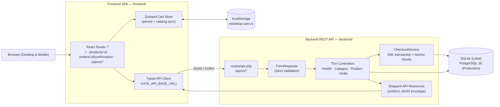

# MiniShop — Product Catalog & Shopping Cart

**MiniShop** adalah aplikasi e-commerce fullstack ringkas yang terdiri dari etalase publik untuk pembeli (**Customer Storefront**) dan panel operasional untuk pengelolaan katalog serta pesanan (**Admin Dashboard**). Proyek ini memisahkan SPA frontend dan REST API backend secara tegas dengan fokus pada konsistensi transaksi stok atomik, validasi server-side ketat, persistensi keranjang belanja, dan antarmuka responsif lintas desktop (`1440px`) maupun mobile (`375px`).

---

## Daftar Isi

- [Fitur Utama](#fitur-utama)
- [Arsitektur & Tech Stack](#arsitektur--tech-stack)
- [Instalasi & Menjalankan Lokal](#instalasi--menjalankan-lokal)
- [Automated Tests, Lint & Build](#automated-tests-lint--build)
- [Daftar REST API Endpoints](#daftar-rest-api-endpoints)
- [Struktur Folder Monorepo](#struktur-folder-monorepo)
- [Keputusan Desain & Arsitektur Kunci](#keputusan-desain--arsitektur-kunci)
- [Persiapan Deployment](#persiapan-deployment)
- [Known Limitations & Trade-offs](#known-limitations--trade-offs)
- [Dokumentasi Pendukung](#dokumentasi-pendukung)

---

## Fitur Utama

### 1. Customer Storefront (`/` & `/products/:id`)
- **Katalog Produk Responsif:** Grid produk dengan foto rasio tetap `4:3` (`ProductImage` dengan lazy-loading dan fallback otomatis saat URL gambar gagal dimuat), kategori, deskripsi ringkas, harga Rupiah terformat (`Intl.NumberFormat('id-ID')` + `tabular-nums`), serta status stok real-time (`Stok: X`, `Sisa X`, atau `Stok Habis` dengan CTA nonaktif).
- **Pencarian, Filter & Pengurutan:** Pencarian nama produk (*debounced* 300ms, *case-insensitive*), filter kategori dinamis dari `GET /api/v1/categories`, serta pengurutan (`Terbaru`, `Harga Terendah`, `Harga Tertinggi`, `Nama A–Z`).
- **Detail Produk:** Dapat dibuka lewat modal di katalog maupun diakses langsung melalui URL `/products/:id` lengkap dengan pemilih jumlah sesuai sisa stok.

### 2. Persistent Shopping Cart
- **Slide-Over Cart Drawer:** Kontrol `-`, input angka langsung, dan `+` dengan penjagaan batas ketat (`1 <= quantity <= maxStock`), hapus satuan, maupun kosongkan keranjang.
- **Kalkulasi Real-Time:** Menghitung *line total*, jumlah unit total (badge pada navbar), dan *grand total* secara otomatis.
- **Persistensi `localStorage`:** State keranjang disimpan pada key `minishop-cart-v1` sehingga tetap utuh saat halaman dimuat ulang, dilengkapi re-sinkronisasi otomatis terhadap katalog terbaru (`syncWithCatalog`).

### 3. Atomic Checkout & Order Confirmation (`/orders/:id/confirmation`)
- **Checkout Ringan Tanpa Payment Gateway:** Form pembeli (`customer_name` wajib, `customer_email` dan `notes` opsional) dengan proteksi anti *double-submit*.
- **Validasi & Pengurangan Stok Atomik:** Server memverifikasi eksistensi produk, kecukupan stok, dan menghitung seluruh harga di sisi server dalam satu transaksi database.
- **Pemulihan Error `409 Conflict` di UI:** Jika stok berubah atau produk dihapus sebelum checkout selesai, UI menampilkan rincian konflik per item beserta tombol 1-klik **"Sesuaikan Semua ke Stok Tersedia"**.
- **Konfirmasi Pesanan:** Setelah `201 Created`, keranjang di Zustand + `localStorage` otomatis dikosongkan, katalog disegarkan, dan pengguna diarahkan ke halaman konfirmasi yang tetap menampilkan nota saat di-refresh (`GET /api/v1/orders/{id}`).

### 4. Admin Dashboard (`/admin`)
- **Ringkasan Operasional (`AdminLayout`):** Metrik Produk Aktif, Stok Menipis & Habis, serta Total Pesanan, dilengkapi navigasi langsung ke `/admin/products`, `/admin/orders`, dan Storefront (`/`).
- **Kelola Produk (`/admin/products`):** Tabel responsif (beralih ke tampilan kartu di mobile), search & filter kategori, modal Tambah/Edit produk dengan validasi inline `422` per field dan live preview gambar `4:3`, serta hapus produk berbasis konfirmasi (`ConfirmDialog`) menggunakan `SoftDeletes`.
- **Kelola Pesanan (`/admin/orders`):** Daftar pesanan terurut terbaru beserta modal detail pesanan yang menampilkan snapshot item permanen saat transaksi berlangsung.

---

## Arsitektur & Tech Stack



| Layer | Teknologi | Alasan Pemilihan |
|---|---|---|
| **Frontend Core** | React 19, Vite 8, TypeScript (`strict`) | SPA murni cocok dipasangkan dengan REST API terpisah tanpa *hydration mismatch* saat membaca `localStorage`, build instan, serta *compile-time type safety* untuk kontrak API. |
| **Styling & Routing** | Tailwind CSS v4, React Router 7, Lucide React | Utility-first CSS + *design tokens* mempercepat layout responsif desktop/mobile yang konsisten, routing deklaratif Storefront/Admin, dan ikon SVG ringan. |
| **State Management** | Zustand 5 (`persist` middleware) | Minim boilerplate dibanding Redux, selector granular mencegah re-render berlebih, serta menyediakan persistensi `localStorage` dengan kontrol sanitasi rehydration. |
| **Backend API** | Laravel 13 (PHP 8.4+), Eloquent ORM | Ekosistem *batteries-included* untuk migration, seeder, `FormRequest`, API Resources, `SoftDeletes`, `DB::transaction`, dan HTTP Feature Tests secara native. |
| **Database** | SQLite (lokal) & PostgreSQL (production) | SQLite memungkinkan setup lokal nol-konfigurasi tanpa Docker; kode migration, pencarian, dan checkout sudah dirancang kompatibel penuh dengan PostgreSQL (`CHECK` constraints, `ILIKE`, `lockForUpdate()`). |
| **Quality & Testing** | PHPUnit 12, Laravel Pint, TypeScript `tsc`, Oxlint | Verifikasi otomatis kebenaran transaksi stok, validasi tipe statis, dan konsistensi format kode lintas stack. |

---

## Instalasi & Menjalankan Lokal

### Prerequisites
- **PHP >= 8.4** (dibutuhkan oleh paket Symfony 8.1 pada `composer.lock`) dengan ekstensi: `pdo_sqlite`, `pdo_pgsql`, `mbstring`, `intl`, `openssl`, `xml`, `ctype`, `fileinfo`, `zip`.
- **Composer 2.x**
- **Node.js >= 20** (disarankan LTS 20/22/24) & **npm**

### 1. Clone Repository

```bash
git clone https://github.com/AnjuDialectic/MiniShop.git
cd MiniShop
```

### 2. Setup Backend (Laravel REST API)

```bash
cd backend
composer install
cp .env.example .env
php artisan key:generate
```

Siapkan file database SQLite lokal lalu jalankan migration dan seeder:

```bash
touch database/database.sqlite
php artisan migrate:fresh --seed
```

Perintah `php artisan migrate:fresh --seed` mengisi data awal secara idempotent:
- **10 produk dummy** lintas 4 kategori (`Elektronik`, `Aksesoris`, `Fashion`, `Rumah Tangga`), termasuk:
  - **1 produk `stock = 0`** (*Earbuds Wireless ANC Sony WF-C700N*) untuk langsung menguji badge **Stok Habis** dan tombol beli nonaktif.
  - **1 produk `stock = 2`** (*Laptop Sleeve Kulit Vegan 14 Inch*) untuk langsung menguji badge **Sisa 2** dan batas maksimum quantity.
- **2 sample order historis** (`ORD-20261119-0001` dan `ORD-20261120-0002`) lengkap dengan `order_items` agar halaman `/admin/orders` dan modal detail order langsung memiliki data siap tinjau.

> **Menggunakan PostgreSQL secara lokal:** Ubah `DB_CONNECTION=pgsql` dan isi `DB_URL` / `DATABASE_URL` atau `DB_HOST`, `DB_PORT`, `DB_DATABASE`, `DB_USERNAME`, `DB_PASSWORD` pada `backend/.env`, lalu jalankan ulang `php artisan migrate:fresh --seed`.

Jalankan server API backend:

```bash
php artisan serve
# API aktif di http://localhost:8000 (health check: http://localhost:8000/api/v1/health)
```

### 3. Setup Frontend (React + Vite)

Buka terminal baru dari root repository:

```bash
cd frontend
npm install
cp .env.example .env
npm run dev
```

Akses aplikasi melalui browser:
- **Customer Storefront:** `http://localhost:5173/`
- **Admin Dashboard:** `http://localhost:5173/admin`

---

## Automated Tests, Lint & Build

### Backend
Suite pengujian menggunakan SQLite `:memory:` (dikonfigurasi pada `backend/phpunit.xml`), sehingga tidak menghapus data di `backend/database/database.sqlite`.

```bash
cd backend
php artisan test
vendor/bin/pint --test
```

Cakupan utama Feature Tests:
- `ProductApiTest`: health check, fallback `404` JSON, list + pagination, search *case-insensitive*, filter kategori, sort, CRUD produk, soft delete, validasi `422` (termasuk penolakan `price <= 0`, `stock < 0`, URL non-`http`/`https`).
- `CheckoutTest`: checkout sukses + pengurangan stok + format `order_code`, *server-side price authority*, rollback total `409 Conflict` saat 1 item stok kurang, penolakan produk stok 0 / soft-deleted / tidak ada, simulasi race condition pada conditional update, dan validasi `422` (`items` kosong, duplikat `product_id`, `quantity <= 0`).
- `OrderAdminTest`: urutan daftar order terbaru + `items_count`, keutuhan snapshot `order_items` setelah harga produk diubah dan produk di-soft-delete, serta verifikasi seeder 10 produk & 2 order.

### Frontend

```bash
cd frontend
npm run typecheck
npm run lint
npm run build
```

---

## Daftar REST API Endpoints

**Base URL Lokal:** `http://localhost:8000/api/v1`  
**Headers:** `Accept: application/json`, `Content-Type: application/json`

Semua response memakai amplop JSON konsisten:
- Sukses: `{ "success": true, "message": "...", "data": ..., "meta"?: { ... } }`
- Error (`404` / `409` / `422` / `500`): `{ "success": false, "message": "...", "errors"?: ... }`

| Method | Endpoint | Pengguna | Deskripsi | Status Code |
|---|---|---|---|---|
| `GET` | `/api/v1/health` | System | Cek kesehatan aplikasi & koneksi database | `200`, `503` |
| `GET` | `/api/v1/categories` | Public | Daftar kategori unik dari produk aktif (terurut A–Z) | `200` |
| `GET` | `/api/v1/products` | Public & Admin | Daftar produk aktif (`?search=`, `?category=`, `?sort=newest\|price_asc\|price_desc\|name_asc`, `?per_page=`) | `200` |
| `GET` | `/api/v1/products/{id}` | Public & Admin | Detail satu produk aktif | `200`, `404` |
| `POST` | `/api/v1/products` | Admin | Tambah produk baru | `201`, `422` |
| `PUT` | `/api/v1/products/{id}` | Admin | Perbarui data produk | `200`, `404`, `422` |
| `DELETE` | `/api/v1/products/{id}` | Admin | Soft delete produk (`deleted_at`) | `200`, `404` |
| `POST` | `/api/v1/orders` | Customer | Checkout atomik (buat order + snapshot + potong stok) | `201`, `409`, `422` |
| `GET` | `/api/v1/orders` | Admin | Daftar pesanan terurut terbaru + `items_count` (`?per_page=`) | `200` |
| `GET` | `/api/v1/orders/{id}` | Admin & Customer | Detail pesanan lengkap beserta array `items` snapshot | `200`, `404` |

### Contoh Kontrak Produk (`GET /api/v1/products` & `POST /api/v1/products`)

**Response `200 OK` (`GET /api/v1/products?search=keyboard&category=Elektronik`):**
```json
{
  "success": true,
  "message": "Daftar produk berhasil diambil.",
  "data": [
    {
      "id": 1,
      "name": "Mechanical Keyboard Keychron K2 Wireless",
      "description": "Keyboard mekanikal compact 75% dengan koneksi Bluetooth 5.1 dan USB-C...",
      "price": 1299000,
      "stock": 8,
      "category": "Elektronik",
      "image_url": "https://images.unsplash.com/photo-1587829741301-dc798b83add3?auto=format&fit=crop&w=800&q=80",
      "is_in_stock": true,
      "created_at": "2026-11-20T12:00:00+07:00",
      "updated_at": "2026-11-20T12:00:00+07:00"
    }
  ],
  "meta": {
    "total": 1,
    "per_page": 20,
    "current_page": 1,
    "last_page": 1
  }
}
```

**Request (`POST /api/v1/products`) → Response `201 Created`:**
```json
{
  "name": "Mousepad Deskmat Felt 80x30cm",
  "description": "Alas meja bahan wool felt halus anti-slip untuk setup kerja minimalis.",
  "price": 149000,
  "stock": 12,
  "category": "Aksesoris",
  "image_url": "https://images.unsplash.com/photo-1616628188550-808682f3926d?auto=format&fit=crop&w=800&q=80"
}
```

### Contoh Kontrak Checkout (`POST /api/v1/orders`)

**Request:**
```json
{
  "customer_name": "Budi Santoso",
  "customer_email": "budi@example.com",
  "notes": "Tolong packing bubble wrap tebal.",
  "items": [
    { "product_id": 1, "quantity": 1 },
    { "product_id": 5, "quantity": 2 }
  ]
}
```

**Response `201 Created`:**
```json
{
  "success": true,
  "message": "Pesanan berhasil dibuat.",
  "data": {
    "id": 3,
    "order_code": "ORD-20261120-A1B2C3",
    "customer_name": "Budi Santoso",
    "customer_email": "budi@example.com",
    "notes": "Tolong packing bubble wrap tebal.",
    "status": "completed",
    "total_quantity": 3,
    "items_count": 2,
    "total_amount": 1789000,
    "created_at": "2026-11-20T12:00:00+07:00",
    "items": [
      {
        "id": 6,
        "product_id": 1,
        "product_name": "Mechanical Keyboard Keychron K2 Wireless",
        "product_image_url": "https://images.unsplash.com/photo-1587829741301-dc798b83add3?auto=format&fit=crop&w=800&q=80",
        "unit_price": 1299000,
        "quantity": 1,
        "subtotal": 1299000
      },
      {
        "id": 7,
        "product_id": 5,
        "product_name": "Laptop Sleeve Kulit Vegan 14 Inch",
        "product_image_url": "https://images.unsplash.com/photo-1553062407-98eeb64c6a62?auto=format&fit=crop&w=800&q=80",
        "unit_price": 245000,
        "quantity": 2,
        "subtotal": 490000
      }
    ]
  }
}
```

**Response `409 Conflict` (stok berubah / produk tidak tersedia — rollback penuh):**
```json
{
  "success": false,
  "message": "Stok produk tidak mencukupi untuk menyelesaikan pesanan.",
  "errors": {
    "items": [
      {
        "product_id": 5,
        "product_name": "Laptop Sleeve Kulit Vegan 14 Inch",
        "requested_quantity": 4,
        "available_stock": 2,
        "reason": "INSUFFICIENT_STOCK"
      }
    ]
  }
}
```

---

## Struktur Folder Monorepo

```text
MiniShop/
├── backend/                           # Laravel 13 REST API
│   ├── app/
│   │   ├── Exceptions/
│   │   │   └── CheckoutConflictException.php
│   │   ├── Http/
│   │   │   ├── Controllers/Api/V1/    # Health, Category, Product, Order controllers
│   │   │   ├── Requests/              # StoreProduct, UpdateProduct, StoreOrder FormRequests
│   │   │   └── Resources/             # ProductResource, OrderResource, OrderItemResource
│   │   ├── Models/                    # Product (SoftDeletes), Order, OrderItem
│   │   ├── Services/
│   │   │   └── CheckoutService.php    # Atomic transaction & stock deduction
│   │   └── Support/
│   │       └── ApiResponse.php        # Uniform JSON response helper
│   ├── bootstrap/app.php              # Global API JSON exception mapping (404/409/422/500)
│   ├── config/
│   │   ├── cors.php                   # Dynamic origin allowlist dari FRONTEND_URL
│   │   └── database.php               # SQLite lokal + PostgreSQL (DB_URL / DATABASE_URL)
│   ├── database/
│   │   ├── factories/ProductFactory.php
│   │   ├── migrations/                # products, orders, order_items (+ pgsql CHECK)
│   │   └── seeders/                   # DatabaseSeeder, ProductSeeder (10), OrderSeeder (2)
│   ├── routes/api.php
│   ├── tests/Feature/                 # ProductApiTest, CheckoutTest, OrderAdminTest
│   ├── Dockerfile                     # Container produksi PHP 8.4 + pdo_pgsql/pdo_sqlite
│   ├── .dockerignore
│   └── .env.example
├── frontend/                          # React 19 + Vite 8 + TypeScript + Tailwind v4
│   ├── public/
│   │   └── _redirects                 # SPA fallback untuk Netlify
│   ├── src/
│   │   ├── api/                       # client.ts (ApiError parser), products.ts, orders.ts
│   │   ├── components/
│   │   │   ├── layout/                # AppShell, Navbar
│   │   │   └── ui/                    # Badge, Button, ConfirmDialog, EmptyState, Modal, ProductImage, Toast
│   │   ├── features/
│   │   │   ├── admin/                 # AdminLayout, ProductsTable, ProductFormModal, OrdersTable, OrderDetailModal
│   │   │   ├── cart/                  # CartDrawer, CartItemRow
│   │   │   ├── catalog/               # CatalogPage, CategoryFilter, ProductCard, ProductDetailModal/Page
│   │   │   └── checkout/              # CheckoutModal (409 recovery), OrderConfirmationPage
│   │   ├── hooks/                     # useDebounce, useDialogBehavior
│   │   ├── stores/                    # cartStore (localStorage), toastStore, uiStore
│   │   ├── types/                     # api.ts, cart.ts, order.ts, product.ts
│   │   └── utils/format.ts            # formatIDR, formatDateTime, cn
│   ├── vercel.json                    # SPA fallback untuk Vercel
│   └── .env.example
├── docs/                              # Dokumen perencanaan & spesifikasi (PRD, Architecture, Design, dll.)
├── README.md
├── AI_USAGE.md
└── .gitignore
```

---

## Keputusan Desain & Arsitektur Kunci

### 1. Mekanisme Atomic Checkout & Pemulihan `409 Conflict`
Proses checkout diisolasi dalam `App\Services\CheckoutService::execute()` dengan proteksi berlapis:
1. **Database Transaction (`DB::transaction(..., 3)`):** Membungkus seluruh pembacaan stok, validasi, pengurangan stok, pembuatan `orders`, dan penyimpanan `order_items` agar bersifat *all-or-nothing*.
2. **Deterministic Ordering (`product_id ASC`):** Payload item diurutkan berdasarkan `product_id` menaik (`ksort` + `orderBy('id', 'asc')`) sebelum penguncian baris guna mencegah *deadlock* (*circular wait*) ketika dua transaksi konkuren membeli kombinasi produk dengan urutan berbeda.
3. **Row-Level Locking di PostgreSQL (`lockForUpdate()`):** Saat berjalan pada driver `pgsql`, query mengambil *exclusive row lock* (`SELECT ... FOR UPDATE`) sampai transaksi selesai.
4. **Single-Pass Validation + Conditional Atomic Decrement:** Seluruh item divalidasi sebelum mutasi dimulai. Saat pengurangan stok, backend menjalankan `UPDATE products SET stock = stock - ? WHERE id = ? AND deleted_at IS NULL AND stock >= ?` (`affectedRows === 1`). Ini melindungi konsistensi stok di SQLite maupun PostgreSQL sekaligus dilengkapi constraint PostgreSQL `CHECK (stock >= 0)`.
5. **Server-Authoritative Pricing & Rollback `409 Conflict`:** Harga satuan, subtotal, dan total dihitung murni dari database (input harga dari client diabaikan; duplikasi `product_id` ditolak `422` oleh `StoreOrderRequest`). Jika satu item saja gagal, seluruh transaksi di-rollback dan `CheckoutConflictException` mengembalikan HTTP `409 Conflict` berisi `available_stock` serta `reason` (`INSUFFICIENT_STOCK` / `PRODUCT_UNAVAILABLE`). Di sisi frontend, `CheckoutModal` langsung memanggil `cartStore.applyStockConflicts()` dan menyajikan panel pemulihan per item maupun tombol 1-klik **"Sesuaikan Semua ke Stok Tersedia"**.

### 2. Strategi Snapshot `order_items` + `SoftDeletes` + Nominal `BIGINT`
- Tabel `products` menerapkan `SoftDeletes` (`deleted_at`), sedangkan `order_items.product_id` memakai foreign key `ON DELETE RESTRICT`.
- Saat checkout, `order_items` menyalin `product_name`, `product_image_url`, `unit_price`, `quantity`, dan `subtotal` sebagai snapshot permanen.
- Dampaknya: Admin dapat mengubah harga/nama atau menghapus produk kapan saja tanpa melanggar integritas relasional maupun mengubah nilai historis pada pesanan lama. Seluruh nominal Rupiah disimpan sebagai integer `BIGINT` untuk menghindari *floating-point rounding error*.

### 3. Persistensi Cart (`localStorage` `minishop-cart-v1`)
- `frontend/src/stores/cartStore.ts` menggunakan Zustand `persist` dengan key `minishop-cart-v1`.
- Saat aplikasi dimuat ulang, `merge` menyaring dan mensanitasi data `localStorage` (`sanitizePersistedItem`) agar data korup tidak merusak UI.
- Setiap kali katalog dimuat dari API, `syncWithCatalog()` menyegarkan harga, nama, dan `maxStock` pada item di keranjang serta menandai item yang stoknya berkurang atau sudah dihapus sebelum pembeli menekan Checkout.

### 4. Akses Langsung `/admin` Tanpa Autentikasi
- Rute `/admin` (`/admin/products` dan `/admin/orders`) sengaja dibuka langsung tanpa gerbang login sesuai batas pengerjaan case study (< 2 hari) yang tidak mensyaratkan modul autentikasi, sekaligus memudahkan reviewer teknis menguji alur Admin dan sinkronisasinya dengan Storefront secara instan.

---

## Persiapan Deployment

Repository ini sudah dilengkapi konfigurasi produksi siap pakai:

### Frontend (Vercel atau Netlify)
- **Root Directory:** `frontend`
- **Build Command:** `npm run build` · **Output Directory:** `dist`
- **SPA Fallback:** Sudah tersedia di [`frontend/vercel.json`](./frontend/vercel.json) dan [`frontend/public/_redirects`](./frontend/public/_redirects) agar refresh pada `/products/:id`, `/orders/:id/confirmation`, dan `/admin/*` tidak mengembalikan `404`.
- **Environment Variable:**
  - `VITE_API_BASE_URL=https://<domain-backend-anda>/api/v1`

### Backend (Railway atau Render + Managed PostgreSQL)
- **Root Directory:** `backend` · **Build Method:** [`backend/Dockerfile`](./backend/Dockerfile) (PHP 8.4 Alpine + `pdo_pgsql` + `pdo_sqlite` + Composer).
- **Database URL Compatibility:** `backend/config/database.php` membaca `DB_URL` dan otomatis fallback ke `DATABASE_URL` yang disediakan Railway/Render.
- **CORS:** `backend/config/cors.php` membaca daftar origin dari `FRONTEND_URL` (dipisahkan koma, otomatis memangkas spasi dan trailing slash).
- **Environment Variables Production:**
  ```env
  APP_ENV=production
  APP_DEBUG=false
  APP_KEY=base64:...
  APP_URL=https://<domain-backend-anda>
  DB_CONNECTION=pgsql
  DATABASE_URL=postgresql://...
  FRONTEND_URL=https://<domain-frontend-anda>
  RUN_SEEDER=true   # opsional saat deploy awal agar 10 produk & 2 order terisi (idempotent)
  ```

---

## Known Limitations & Trade-offs

1. **Belum Ada Autentikasi pada `/admin`:** Rute `/admin` serta endpoint mutasi produk (`POST`/`PUT`/`DELETE /api/v1/products`) dan daftar order (`GET /api/v1/orders`) belum dilindungi autentikasi/RBAC. Untuk lingkungan produksi nyata, diperlukan Laravel Sanctum / session auth dengan middleware otorisasi peran Admin.
2. **Tanpa Payment Gateway & Alur Fulfillment:** Sesuai spesifikasi, checkout langsung menghasilkan pesanan berstatus `completed` tanpa integrasi pembayaran pihak ketiga, kalkulasi ongkir, pajak, maupun pembatalan/restock otomatis.
3. **SQLite Lokal vs PostgreSQL Production:** Default lokal memakai SQLite agar reviewer dapat menjalankan proyek dalam hitungan detik tanpa setup Docker atau service database terpisah. Fitur *row-level locking* (`lockForUpdate()`) dan constraint `CHECK` pada migration aktif penuh saat driver adalah PostgreSQL (`pgsql`), sementara di SQLite atomisitas tetap dijaga oleh `DB::transaction` dan conditional atomic `UPDATE ... WHERE stock >= ?`.
4. **Input Gambar via URL (Bukan File Upload Biner):** Produk menyimpan `image_url` eksternal (tervalidasi ketat hanya skema `http://` dan `https://`) dengan live thumbnail preview di form Admin dan fallback UI otomatis jika gambar gagal dimuat, tanpa integrasi object storage (S3/R2).
5. **Pengujian Otomatis Terfokus di Backend:** Kontrak API, validasi, snapshot, dan atomic checkout tercover oleh Laravel Feature Tests (`php artisan test`), sedangkan frontend diverifikasi lewat TypeScript strict (`tsc`), `oxlint`, production build (`vite build`), dan pengujian E2E live browser pada viewport `1440px` & `375px` (belum dilengkapi Vitest/Playwright runner otomatis).

---

## Dokumentasi Pendukung

- [`AI_USAGE.md`](./AI_USAGE.md) — Transparansi penggunaan AI tools, pembagian peran, contoh prompt aktual, dan proses verifikasi/koreksi.
- [`docs/PRD.md`](./docs/PRD.md) — Spesifikasi kebutuhan produk, ERD, kontrak API, dan matriks edge cases.
- [`docs/Architecture.md`](./docs/Architecture.md) — Diagram sistem, atomic checkout sequence, dan desain `cartStore`.
- [`docs/Design.md`](./docs/Design.md) — Design system (*Editorial Warm Minimalism*) dan panduan aksesibilitas WCAG 2.2 AA.
- [`docs/USER-FLOW.md`](./docs/USER-FLOW.md) — Alur perjalanan pengguna Customer & Admin.
- [`docs/ENV.md`](./docs/ENV.md) — Referensi lengkap variabel lingkungan lokal, testing, dan production.
- [`docs/TASK.md`](./docs/TASK.md) & [`docs/CHANGELOG.md`](./docs/CHANGELOG.md) — Checklist implementasi bertahap dan riwayat milestone.
