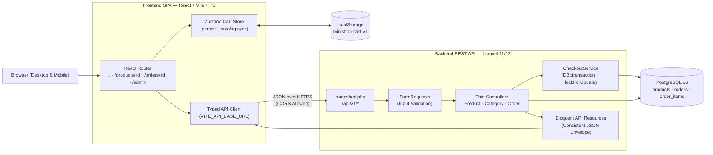
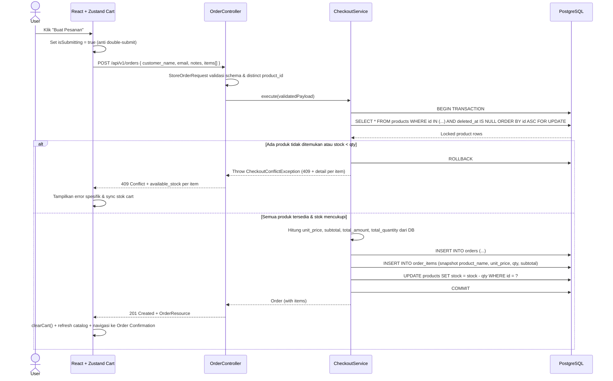

# Architecture Specification — MiniShop

**Stack:** React + Vite (TypeScript, Tailwind CSS, Zustand) · Laravel 11/12 (REST API, Eloquent) · PostgreSQL 16  
**Target:** Clean separation of concerns, strict server-side validation, atomic stock deduction, easy local & cloud run.

---

## 1. High-Level System Architecture



### Prinsip Arsitektur
1. **Stateless REST API:** Backend tidak menyimpan session cart; cart sepenuhnya berada di client hingga tombol Checkout ditekan.
2. **Server as Single Source of Truth:** Harga produk, ketersediaan stok, subtotal item, dan total nominal order selalu dihitung ulang oleh backend menggunakan data database yang terkunci dalam transaksi.
3. **Thin Controllers, Focused Service:** Controller hanya mengatur delegasi request/response. Logika bisnis kritikal (atomic checkout, penguncian baris terurut, kalkulasi, pembuatan snapshot order) diisolasi dalam `App\Services\CheckoutService`.
4. **Uniform Error Contract:** Semua exception API (`ValidationException`, `ModelNotFoundException`, `InsufficientStockException`, `HttpException`) dikonversi oleh handler terpusat di `bootstrap/app.php` menjadi format JSON `{ success: false, message, errors }` yang konsisten.

---

## 2. Struktur Folder Monorepo

```text
MiniShop/
├── docs/                          # 8 Dokumen proyek VibeCoding
│   ├── PRD.md
│   ├── Architecture.md
│   ├── Rules.md
│   ├── Design.md
│   ├── USER-FLOW.md
│   ├── TASK.md
│   ├── ENV.md
│   └── CHANGELOG.md
├── backend/                       # Laravel 11/12 REST API
│   ├── app/
│   │   ├── Exceptions/
│   │   │   └── CheckoutConflictException.php
│   │   ├── Http/
│   │   │   ├── Controllers/Api/V1/
│   │   │   │   ├── CategoryController.php
│   │   │   │   ├── HealthController.php
│   │   │   │   ├── OrderController.php
│   │   │   │   └── ProductController.php
│   │   │   ├── Requests/
│   │   │   │   ├── StoreOrderRequest.php
│   │   │   │   ├── StoreProductRequest.php
│   │   │   │   └── UpdateProductRequest.php
│   │   │   └── Resources/
│   │   │       ├── OrderItemResource.php
│   │   │       ├── OrderResource.php
│   │   │       └── ProductResource.php
│   │   ├── Models/
│   │   │   ├── Order.php
│   │   │   ├── OrderItem.php
│   │   │   └── Product.php
│   │   ├── Services/
│   │   │   └── CheckoutService.php
│   │   └── Support/
│   │       └── ApiResponse.php
│   ├── config/
│   │   └── cors.php
│   ├── database/
│   │   ├── factories/
│   │   │   └── ProductFactory.php
│   │   ├── migrations/
│   │   │   ├── xxxx_create_products_table.php
│   │   │   ├── xxxx_create_orders_table.php
│   │   │   └── xxxx_create_order_items_table.php
│   │   └── seeders/
│   │       ├── DatabaseSeeder.php
│   │       ├── OrderSeeder.php
│   │       └── ProductSeeder.php
│   ├── routes/
│   │   └── api.php
│   ├── tests/Feature/
│   │   ├── CheckoutTest.php
│   │   ├── OrderAdminTest.php
│   │   └── ProductApiTest.php
│   ├── Dockerfile
│   └── .env.example
├── frontend/                      # React + Vite + TypeScript + Tailwind
│   ├── public/
│   │   └── _redirects             # SPA fallback untuk Netlify
│   ├── src/
│   │   ├── api/
│   │   │   ├── client.ts          # Fetch wrapper + typed ApiError
│   │   │   ├── orders.ts
│   │   │   └── products.ts
│   │   ├── components/
│   │   │   ├── layout/
│   │   │   │   ├── AppShell.tsx
│   │   │   │   └── Navbar.tsx
│   │   │   └── ui/
│   │   │       ├── Badge.tsx
│   │   │       ├── Button.tsx
│   │   │       ├── ConfirmDialog.tsx
│   │   │       ├── EmptyState.tsx
│   │   │       ├── Modal.tsx
│   │   │       ├── ProductImage.tsx
│   │   │       └── Toast.tsx
│   │   ├── features/
│   │   │   ├── admin/
│   │   │   │   ├── AdminLayout.tsx
│   │   │   │   ├── OrderDetailModal.tsx
│   │   │   │   ├── OrdersTable.tsx
│   │   │   │   ├── ProductFormModal.tsx
│   │   │   │   └── ProductsTable.tsx
│   │   │   ├── cart/
│   │   │   │   ├── CartDrawer.tsx
│   │   │   │   └── CartItemRow.tsx
│   │   │   ├── catalog/
│   │   │   │   ├── CatalogPage.tsx
│   │   │   │   ├── CategoryFilter.tsx
│   │   │   │   ├── ProductCard.tsx
│   │   │   │   └── ProductDetailModal.tsx
│   │   │   └── checkout/
│   │   │       ├── CheckoutModal.tsx
│   │   │       └── OrderConfirmationPage.tsx
│   │   ├── hooks/
│   │   │   └── useDebounce.ts
│   │   ├── stores/
│   │   │   ├── cartStore.ts       # Zustand + persist localStorage
│   │   │   └── toastStore.ts
│   │   ├── types/
│   │   │   ├── api.ts
│   │   │   ├── cart.ts
│   │   │   ├── order.ts
│   │   │   └── product.ts
│   │   ├── utils/
│   │   │   └── format.ts          # Format IDR & tanggal Indonesia
│   │   ├── App.tsx
│   │   ├── index.css
│   │   └── main.tsx
│   ├── vercel.json                # SPA fallback untuk Vercel
│   └── .env.example
├── docker-compose.yml             # PostgreSQL 16 lokal 1 perintah
├── README.md
└── AI_USAGE.md
```

---

## 3. Atomic Checkout & Concurrency Design

Proses checkout merupakan titik paling kritis pada aplikasi e-commerce. Berikut alur sinkronisasi database pada `CheckoutService::execute()`:



### Proteksi Berlapis (Defense in Depth)
1. **Deterministic Lock Ordering:** `ORDER BY id ASC FOR UPDATE` mencegah circular wait (deadlock) antar transaksi konkuren.
2. **Single-Pass Validation Before Write:** Semua item dicek terlebih dahulu sebelum satu pun baris stok dikurangi; jika item ke-3 stoknya kurang, item ke-1 dan ke-2 tidak pernah terkurangi (serta seluruh transaksi di-rollback).
3. **PostgreSQL Check Constraint:** `ALTER TABLE products ADD CONSTRAINT products_stock_non_negative CHECK (stock >= 0)` menjamin level database menolak nilai negatif meski ada bug logika di aplikasi.
4. **Readable Unique Order Code:** Format `ORD-YYYYMMDD-XXXXXX` (kombinasi tanggal + random/sequence terverifikasi unik) untuk identifikasi yang mudah dibaca manusia di UI konfirmasi dan tabel Admin.

---

## 4. State Management Frontend (`cartStore`)

### Data Tersimpan di `localStorage` (`minishop-cart-v1`)
```ts
export interface CartItem {
  productId: number;
  name: string;
  price: number;        // Disegarkan dari catalog saat sync
  imageUrl: string;
  category: string;
  maxStock: number;     // Disegarkan dari catalog saat sync
  quantity: number;     // Selalu 1 <= quantity <= maxStock
  unavailable?: boolean; // True jika produk dihapus / stok 0 saat sync
}
```

### Aksi Utama `cartStore`
- `addItem(product, qty = 1)`: Validasi `product.stock > 0`; jika item sudah ada, tambah qty dan clamp maksimal ke `product.stock`; kembalikan hasil status (`added` | `capped` | `out_of_stock`) agar UI memberi toast yang akurat.
- `updateQuantity(productId, qty)`: Clamp `Math.max(1, Math.min(qty, item.maxStock))`.
- `removeItem(productId)`: Hapus item dari array.
- `clearCart()`: Kosongkan keranjang (dipanggil setelah checkout `201 Created`).
- `syncWithCatalog(products)`: Setiap kali daftar produk terbaru diterima dari server, perbarui `name`, `price`, `imageUrl`, dan `maxStock` pada item di keranjang; tandai `unavailable = true` jika produk hilang atau stok menjadi `0`, atau tandai konflik jika `quantity > latestStock`.
- `applyStockConflicts(conflicts)`: Memperbarui `maxStock` secara instan dari payload error `409 Conflict` backend saat checkout gagal karena stok berubah.

---

## 5. Rencana Deployment (Opsional / Nilai Plus)

| Komponen | Platform Rekomendasi | Konfigurasi |
|---|---|---|
| **Frontend (SPA)** | **Vercel** atau **Netlify** | Root directory `frontend/`, build `npm run build`, output `dist/`, SPA rewrite via `vercel.json` / `_redirects`, env `VITE_API_BASE_URL`. |
| **Backend (Laravel API)** | **Railway** atau **Render** | Root directory `backend/`, deploy via `Dockerfile` (PHP 8.3 + pdo_pgsql + Composer + Nginx/PHP built-in/Octane-free lightweight start), auto-run `php artisan migrate --force` pada start command. |
| **Database** | **Railway PostgreSQL** / **Neon** / **Supabase** | Managed PostgreSQL 16 dihubungkan lewat `DATABASE_URL` atau `DB_HOST/PORT/DATABASE/USERNAME/PASSWORD`. |
