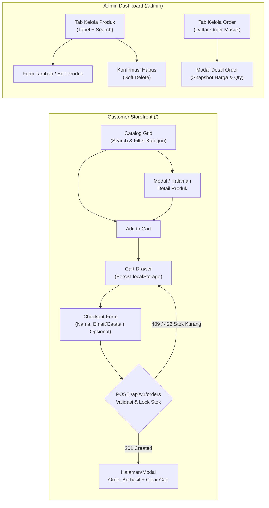
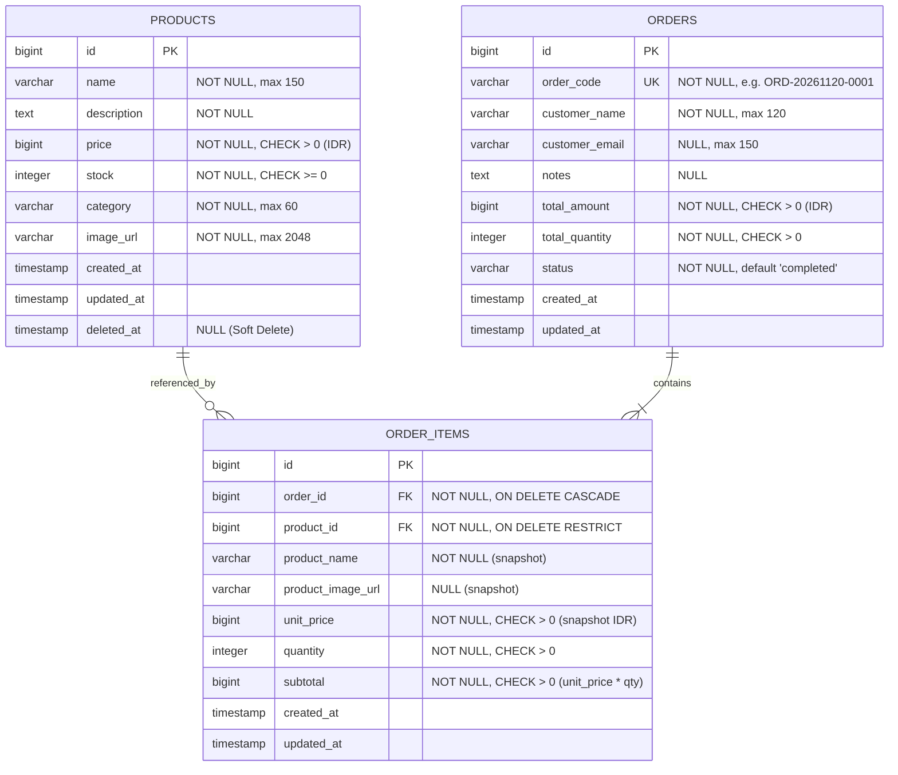

# Product Requirements Document (PRD) — MiniShop

**Versi:** 1.0.0  
**Tanggal:** 20 November 2026  
**Konteks Proyek:** Case Study Fullstack Engineer — Roketin  
**Target Pengerjaan:** < 2 Hari (~16 Jam Kerja Efektif)  
**Dokumen Terkait:** [Architecture.md](./Architecture.md) · [USER-FLOW.md](./USER-FLOW.md) · [Design.md](./Design.md) · [Rules.md](./Rules.md) · [TASK.md](./TASK.md) · [ENV.md](./ENV.md)

---

## 1. Ringkasan Produk

### 1.1 Overview
**MiniShop** adalah aplikasi web e-commerce ringkas (*Product Catalog & Shopping Cart*) yang mencakup etalase publik untuk pembeli (*Customer Storefront*) dan panel operasional sederhana untuk pengelolaan katalog serta pesanan (*Admin Dashboard*). Proyek ini dirancang untuk mendemonstrasikan standar rekayasa *fullstack* yang bersih, validasi backend yang ketat, konsistensi data transaksi stok secara atomik, antarmuka responsif lintas perangkat, serta kemudahan dijalankan secara lokal maupun dideploy ke cloud.

### 1.2 Tujuan Utama
1. **Keandalan Data & Transaksi:** Menjamin stok produk tidak pernah negatif atau terkena *race condition* saat beberapa transaksi checkout berlangsung bersamaan.
2. **Arsitektur Bersih & Terpisah:** Memisahkan tanggung jawab antara SPA Frontend dan REST API Backend secara jelas sehingga mudah dibaca, diuji, dan dikembangkan lebih lanjut oleh reviewer maupun tim engineering.
3. **Pengalaman Pengguna Cepat & Jelas:** Menyediakan katalog responsif, keranjang belanja persisten di `localStorage`, umpan balik validasi stok secara instan, dan alur checkout tanpa friksi.
4. **Siap Review & Deploy:** Menyediakan migrasi database, seeder 10 produk dummy + contoh order, dokumentasi `README.md` & `AI_USAGE.md`, serta konfigurasi deployment siap pakai.

### 1.3 Target Pengguna
| Persona | Peran | Kebutuhan Utama |
|---|---|---|
| **Customer (Pembeli)** | Pengunjung publik storefront (`/`) | Mencari dan memfilter produk, melihat detail & ketersediaan stok, mengelola keranjang belanja yang tidak hilang saat refresh, dan menyelesaikan checkout dengan ringkasan order jelas. |
| **Admin (Operator Toko)** | Pengelola katalog & pesanan (`/admin`) | Menambah, memperbarui, dan menghapus produk beserta stok/harga, serta memantau daftar order masuk beserta rincian item yang dibeli. |
| **Technical Reviewer** | Tim Engineering Roketin | Menjalankan proyek lokal dengan cepat, menguji edge cases validasi & stok atomik, meninjau kualitas kode, kontrak API, `README.md`, dan `AI_USAGE.md`. |

### 1.4 Pilihan Tech Stack & Alasan Pemilihan

| Layer | Teknologi Terpilih | Alasan Pemilihan |
|---|---|---|
| **Frontend** | **React + Vite + TypeScript + Tailwind CSS** | Arsitektur SPA murni sangat ideal berpasangan dengan backend REST API terpisah; bebas dari konflik SSR/*hydration mismatch* ketika membaca state cart dari `localStorage`; waktu build & HMR sangat cepat untuk sprint 2 hari; hasil build statis mudah dideploy ke Vercel/Netlify. |
| **State Management Cart** | **Zustand (`persist` middleware ke `localStorage`)** | Ringan, minim boilerplate dibanding Redux, lebih optimal dari React Context untuk re-render selektif, dan memiliki mekanisme persistensi `localStorage` bawaan yang bersih serta mudah di-sync ulang dengan stok server. |
| **Backend** | **Laravel 11/12 (REST API + Eloquent ORM)** | Sangat produktif untuk deadline 2 hari berkat fitur bawaan yang matang: Database Migration, Seeder, `FormRequest` validation, Eloquent API Resources, `SoftDeletes`, `DB::transaction()` + `lockForUpdate()`, dan Feature Test HTTP bawaan. |
| **Database** | **PostgreSQL 16** | Mendukung *row-level locking* sejati (`SELECT ... FOR UPDATE`) untuk transaksi checkout atomik, constraint `CHECK` di level database, pencarian case-insensitive (`ILIKE`), dan persisten secara aman saat dideploy di cloud (Railway/Render/Neon). Dilengkapi `docker-compose.yml` agar berjalan lokal dalam satu perintah. |
| **Admin Access** | **Direct Route (`/admin`) tanpa autentikasi** | Menjaga fokus pengerjaan dalam batas 2 hari sesuai spesifikasi case study (tanpa mewajibkan modul auth) sekaligus mempermudah reviewer menguji alur admin secara langsung. Keterbatasan ini didokumentasikan secara transparan pada bagian *Known Limitations* di `README.md`. |

### 1.5 Batasan Scope (Non-Goals)
Fitur berikut **secara sadar tidak masuk** dalam scope 2 hari:
- Integrasi payment gateway (Midtrans/Xendit/Stripe) dan status pembayaran lanjutan.
- Sistem autentikasi user/customer, registrasi akun, atau RBAC multi-role.
- Kalkulasi ongkos kirim, kupon diskon, pajak bertingkat, atau manajemen multi-gudang.
- Upload file gambar biner ke object storage (produk menggunakan URL gambar tervalidasi dengan fallback otomatis jika gambar gagal dimuat).

---

## 2. Ringkasan User Flow

Detail lengkap setiap skenario, diagram status, dan transisi layar tersedia pada [USER-FLOW.md](./USER-FLOW.md).



---

## 3. Spesifikasi Fungsional

### 3.1 Customer Side — Public Storefront

#### FR-C1: Product Catalog (`/`)
1. **Daftar Produk:** Menampilkan produk aktif (`deleted_at IS NULL`) dalam grid responsif (1 kolom mobile, 2 kolom tablet, 3–4 kolom desktop). Setiap kartu produk menampilkan:
   - Gambar produk (rasio konsisten `4:3`, `object-cover`, lazy-loaded, dengan fallback placeholder jika URL rusak).
   - Badge kategori.
   - Nama produk.
   - Deskripsi singkat (maksimal 2 baris dengan ellipsis).
   - Harga terformat mata uang Rupiah (contoh: `Rp 249.000`).
   - Indikator jumlah stok tersedia.
   - Tombol **"Tambah ke Keranjang"**.
2. **Pencarian Produk:** Input search berdasarkan nama produk dengan *debounce* 300ms, memicu query `GET /api/v1/products?search=...` secara *case-insensitive*.
3. **Filter Kategori:** Deretan pill/tab kategori (`Semua` + daftar kategori dinamis dari `GET /api/v1/categories`) yang dapat dikombinasikan dengan pencarian nama.
4. **Detail Produk (Modal atau `/products/:id`):** Klik kartu produk membuka modal detail responsif (serta mendukung rute langsung `/products/:id` agar *shareable*) yang menampilkan gambar penuh, nama, kategori, harga, deskripsi lengkap, status stok, kontrol jumlah (`qty`), dan tombol tambah ke keranjang.
5. **Indikator Status Stok:**
   - `stock === 0`: Tampilkan badge **"Stok Habis"**, visual kartu sedikit diredam, dan tombol beli berstatus `disabled`.
   - `1 <= stock <= 3`: Tampilkan indikator stok terbatas (contoh: **"Sisa 2"**) agar pembeli sadar keterbatasan stok.
   - `stock > 3`: Tampilkan jumlah stok tersedia (contoh: **"Stok: 12"**).
   - Jika produk sudah berada di keranjang hingga mencapai batas stok (`cartQty >= stock`), tombol tambah di catalog menampilkan status **"Maksimal di Keranjang"** (`disabled`) atau mengarahkan untuk membuka keranjang.

#### FR-C2: Shopping Cart (Slide-over Drawer & Sinkronisasi `localStorage`)
1. **Tambah ke Keranjang:** Pengguna dapat menambahkan produk dari kartu catalog (default `+1`) maupun dari modal/halaman detail produk (sesuai qty pilihan).
2. **Update Quantity:** Di dalam Cart Drawer, setiap item memiliki tombol `-`, input angka langsung, dan tombol `+`:
   - Minimal quantity adalah `1`.
   - Maksimal quantity adalah `product.stock` (tombol `+` otomatis disabled saat `qty === stock`; input manual di atas stok otomatis di-clamp ke `stock` disertai peringatan inline).
   - Mengurangi dari `1` tidak otomatis menghapus tanpa niat jelas — tombol `-` disabled pada `qty === 1`, dan penghapusan menggunakan tombol **Hapus** eksplisit.
3. **Hapus Item:** Pengguna dapat menghapus satu item atau mengosongkan seluruh keranjang.
4. **Kalkulasi Otomatis:**
   - Harga per item (*line total*): `unitPrice * quantity`.
   - Total jumlah barang (*total items*): jumlah seluruh `quantity` (ditampilkan juga sebagai badge angka pada ikon Keranjang di navbar).
   - Subtotal keseluruhan: penjumlahan seluruh *line total*.
5. **Persistensi `localStorage`:** State keranjang disimpan di `localStorage` dengan key `minishop-cart-v1` menggunakan Zustand `persist`. Isi keranjang tetap utuh saat halaman di-refresh atau tab dibuka ulang.
6. **Re-validasi Stale Cart:** Ketika katalog berhasil dimuat dari server, frontend mencocokkan item di `localStorage` terhadap data produk terbaru:
   - Memperbarui tampilan harga & stok terbaru.
   - Menandai item jika stok server turun di bawah `qty` di keranjang atau produk sudah dihapus/habis, sehingga pengguna dapat menyesuaikannya sebelum checkout.

#### FR-C3: Checkout & Konfirmasi Order
1. **Form Checkout Ringan:** Di dalam panel/halaman checkout (tanpa payment gateway), pembeli melihat ringkasan item & total harga serta mengisi:
   - `customer_name` (**wajib**, min 2 karakter, maks 120 karakter).
   - `customer_email` (opsional; jika diisi wajib format email valid).
   - `notes` (opsional; catatan pengiriman/pesanan, maks 500 karakter).
2. **Proses Submit:** Klik **"Buat Pesanan (Checkout)"**:
   - Tombol masuk status `loading` & `disabled` untuk mencegah *double submit*.
   - Mengirim payload `{ customer_name, customer_email, notes, items: [{ product_id, quantity }] }` ke `POST /api/v1/orders`.
   - **Frontend tidak mengirim harga atau total sebagai sumber kebenaran**; backend menghitung semuanya dari database.
3. **Mutasi Backend Atomik:** Backend memverifikasi setiap produk & stok, membuat record `orders` dan `order_items`, serta mengurangi `products.stock` dalam satu Database Transaction.
4. **Sukses Checkout (`201 Created`):**
   - Keranjang di Zustand + `localStorage` otomatis dikosongkan.
   - Data katalog di-refresh agar stok terbaru langsung tercermin di halaman catalog.
   - Pengguna diarahkan ke tampilan/halaman konfirmasi **"Order Berhasil"** (`/orders/:id/confirmation` atau modal konfirmasi persisten) yang menampilkan:
     - Nomor Order (`order_code`, contoh: `ORD-20261120-0001`).
     - Tanggal & waktu transaksi.
     - Nama pembeli (serta email/catatan jika diisi).
     - Daftar item (nama produk, qty, harga satuan, subtotal item).
     - Total harga keseluruhan.
     - Tombol **"Kembali Belanja"**.

---

### 3.2 Admin Side (`/admin`)

#### FR-A1: Kelola Produk (CRUD — `/admin/products`)
1. **Tabel Produk:** Menampilkan seluruh produk aktif (thumbnail, nama, kategori, harga terformat IDR, stok dengan badge status warna, tanggal update, tombol Edit & Hapus) dilengkapi fitur search & filter kategori.
2. **Tambah Produk:** Modal/form dengan field:
   - Nama produk (wajib, maks 150 karakter).
   - Kategori (wajib, pilih dari daftar kategori atau input kategori kustom maks 60 karakter).
   - Harga dalam Rupiah (wajib, integer `> 0`).
   - Stok (wajib, integer `>= 0`).
   - Deskripsi singkat (wajib, maks 1000 karakter).
   - URL Gambar (wajib, format URL `http://` atau `https://`, disertai live thumbnail preview & indikator jika URL gagal dimuat).
3. **Edit Produk:** Membuka form yang terisi data produk saat ini untuk memperbarui field apa pun, termasuk penyesuaian harga atau restock stok.
4. **Hapus Produk:** Menampilkan dialog konfirmasi eksplisit ("Yakin hapus produk X? Riwayat order sebelumnya tetap aman.") lalu memanggil `DELETE /api/v1/products/{id}` (soft delete).

#### FR-A2: Kelola Order (`/admin/orders`)
1. **Daftar Order Masuk:** Tabel terurut dari transaksi terbaru (`created_at DESC`) menampilkan:
   - Kode Order (`order_code`).
   - Tanggal & waktu transaksi.
   - Nama pembeli (& email jika ada).
   - Ringkasan jumlah item (`total_items_count` jenis produk / `total_quantity` unit).
   - Total nominal transaksi (`total_amount`).
   - Tombol **"Lihat Detail"**.
2. **Detail Order (Modal / Drawer):** Memanggil `GET /api/v1/orders/{id}` untuk menampilkan:
   - Header metadata order (`order_code`, waktu, nama pembeli, email, catatan).
   - Tabel rincian `order_items`: nama produk saat transaksi (`product_name`), harga satuan saat transaksi (`unit_price`), jumlah (`quantity`), dan subtotal item (`subtotal`).
   - Total keseluruhan order (`total_amount`).

---

### 3.3 Aturan Bisnis & Validasi Backend (Wajib)

1. **Validasi Input Ketat:** Semua endpoint mutasi (`POST`/`PUT`) wajib menggunakan Laravel `FormRequest`:
   - `products`: `name` required string max 150; `price` required integer min 1; `stock` required integer min 0; `category` required string max 60; `description` required string max 1000; `image_url` required active/valid URL (`http`/`https`) max 2048.
   - `orders`: `customer_name` required string min 2 max 120; `customer_email` nullable email max 150; `notes` nullable string max 500; `items` required array min 1; `items.*.product_id` required integer distinct; `items.*.quantity` required integer min 1.
2. **Server-Authoritative Pricing:** Harga satuan (`unit_price`), subtotal per item (`subtotal`), dan `total_amount` wajib dihitung di backend berdasarkan nilai `products.price` terkini di database.
3. **Re-validasi Stok & Keberadaan Produk:** Saat checkout, backend memastikan setiap `product_id` eksis dan tidak berstatus soft-deleted, serta `product.stock >= item.quantity`. Jika ada satu saja item yang tidak valid atau stoknya kurang, seluruh transaksi dibatalkan (*atomic rollback*) dan mengembalikan HTTP `409 Conflict` (atau `422 Unprocessable Entity` untuk error input format) dengan detail item yang bermasalah (termasuk stok tersisa aktual).
4. **Database Transaction Atomik & Anti-Deadlock:**
   - Proses checkout dibungkus dalam `DB::transaction(function () { ... })`.
   - Pengambilan record produk menggunakan penguncian baris **terurut berdasarkan `id ASC`** (`Product::whereIn('id', $productIds)->orderBy('id', 'asc')->lockForUpdate()->get()`) guna mencegah *deadlock* ketika dua transaksi membeli kombinasi produk yang sama dalam urutan berbeda.
   - Pengurangan stok dilakukan dalam transaksi yang sama, diperkuat constraint database `CHECK (stock >= 0)` sebagai lapis pertahanan kedua (*defense in depth*).
5. **Konsistensi Response & HTTP Status Code:**
   - `200 OK`: GET sukses, PUT/DELETE sukses.
   - `201 Created`: POST pembuatan produk atau checkout order sukses.
   - `400 Bad Request`: Payload JSON rusak atau parameter tidak sah.
   - `404 Not Found`: Resource produk/order tidak ditemukan.
   - `409 Conflict`: Konflik aturan bisnis saat checkout (stok tidak mencukupi / produk tidak tersedia lagi).
   - `422 Unprocessable Entity`: Gagal validasi schema/input `FormRequest`.
   - `500 Internal Server Error`: Error tak terduga (format JSON rapi tanpa membocorkan stack trace saat `APP_DEBUG=false`).

---

## 4. Desain Skema Database (PostgreSQL)

### 4.1 Entity Relationship Diagram (ERD)



### 4.2 Keputusan Desain Skema & Indeks

1. **Tipe Data Harga `BIGINT` (Rupiah Integer):** Menyimpan nominal dalam satuan bulat IDR (misal `149000` untuk Rp 149.000) menghindari *floating-point precision bugs* yang umum terjadi pada `FLOAT`/`DOUBLE`.
2. **Soft Delete (`deleted_at`) pada `products` + Snapshot pada `order_items`:**
   - Memungkinkan Admin menghapus produk dari katalog aktif tanpa melanggar relasi foreign key (`ON DELETE RESTRICT`) maupun merusak histori order lama.
   - Kolom `product_name`, `product_image_url`, dan `unit_price` di `order_items` menyimpan salinan data persis saat transaksi terjadi sehingga perubahan harga/nama di masa depan tidak memodifikasi nota pesanan lama.
3. **Database-Level Check Constraints:**
   - `products`: `CHECK (price > 0)`, `CHECK (stock >= 0)`.
   - `orders`: `CHECK (total_amount > 0)`, `CHECK (total_quantity > 0)`.
   - `order_items`: `CHECK (unit_price > 0)`, `CHECK (quantity > 0)`, `CHECK (subtotal > 0)`.
4. **Indexes:**
   - `idx_products_category_deleted` pada `products(category, deleted_at)` untuk mempercepat filter kategori pada produk aktif.
   - `idx_products_name` pada `products(name)` untuk pencarian nama.
   - `idx_orders_created_at` pada `orders(created_at DESC)` untuk urutan daftar order terbaru di Admin.
   - `idx_order_items_order_id` dan `idx_order_items_product_id` pada `order_items`.

### 4.3 Data Seeder Wajib (10 Produk Dummy + 2 Sample Orders)

Seeder bersifat *idempotent* (`firstOrCreate` atau dijalankan lewat `migrate:fresh --seed`) dan mengisi **10 produk lintas 4 kategori** dengan variasi stok strategis untuk memudahkan pengujian reviewer:

| # | Nama Produk | Kategori | Harga (IDR) | Stok | Tujuan Pengujian |
|---|---|---|---|---|---|
| 1 | Mechanical Keyboard Keychron K2 Wireless | Elektronik | 1.299.000 | 8 | Produk reguler |
| 2 | Mouse Ergonomis Logitech MX Master 3S | Elektronik | 1.450.000 | 5 | Produk reguler |
| 3 | Earbuds Wireless ANC Sony WF-C700N | Elektronik | 1.199.000 | **0** | Langsung uji badge **"Stok Habis"** & disabled CTA |
| 4 | USB-C Hub 7-in-1 Aluminum 4K HDMI | Aksesoris | 349.000 | 15 | Produk reguler |
| 5 | Laptop Sleeve Kulit Vegan 14 Inch | Aksesoris | 245.000 | **2** | Langsung uji badge **"Sisa 2"** & batas validasi qty |
| 6 | Stand Laptop Aluminum Foldable | Aksesoris | 189.000 | 20 | Produk reguler |
| 7 | Jaket Overshirt Katun Twill Olive | Fashion | 385.000 | 10 | Produk reguler |
| 8 | Totebag Kanvas Heavyweight 16oz | Fashion | 165.000 | 14 | Produk reguler |
| 9 | Tumbler Vacuum Insulated 600ml Matte Black | Rumah Tangga | 229.000 | 12 | Produk reguler |
| 10 | Lampu Meja LED Minimalis Dimmer | Rumah Tangga | 275.000 | 6 | Produk reguler |

Selain itu, `OrderSeeder` menambahkan **2 sample order historis** agar halaman `/admin/orders` dan modal detail order dapat langsung ditinjau tanpa harus melakukan checkout manual terlebih dahulu.

---

## 5. Kontrak REST API Endpoint

**Base Path:** `/api/v1`  
**Content-Type:** `application/json` · `Accept: application/json`

### 5.1 Format Response Standar

**Success (Single Resource):**
```json
{
  "success": true,
  "message": "Produk berhasil diambil.",
  "data": { }
}
```

**Success (List + Meta):**
```json
{
  "success": true,
  "message": "Daftar produk berhasil diambil.",
  "data": [ ],
  "meta": {
    "total": 10,
    "per_page": 20,
    "current_page": 1,
    "last_page": 1
  }
}
```

**Validation Error (`422 Unprocessable Entity`):**
```json
{
  "success": false,
  "message": "Data yang dikirim tidak valid.",
  "errors": {
    "price": ["Harga harus lebih dari 0."],
    "stock": ["Stok tidak boleh kurang dari 0."]
  }
}
```

**Stock / Business Conflict (`409 Conflict`):**
```json
{
  "success": false,
  "message": "Stok produk tidak mencukupi untuk menyelesaikan pesanan.",
  "errors": {
    "items": [
      {
        "product_id": 5,
        "product_name": "Laptop Sleeve Kulit Vegan 14 Inch",
        "requested_quantity": 4,
        "available_stock": 2,
        "reason": "INSUFFICIENT_STOCK"
      }
    ]
  }
}
```

### 5.2 Ringkasan Endpoint

| Method | Endpoint | Pengguna | Deskripsi | Status Code |
|---|---|---|---|---|
| `GET` | `/api/v1/health` | Infra/System | Cek kesehatan aplikasi & koneksi DB | `200`, `503` |
| `GET` | `/api/v1/categories` | Public | Daftar kategori unik dari produk aktif | `200` |
| `GET` | `/api/v1/products` | Public & Admin | List produk (support `?search=`, `?category=`, `?sort=`, `?per_page=`) | `200` |
| `GET` | `/api/v1/products/{id}` | Public & Admin | Detail satu produk aktif | `200`, `404` |
| `POST` | `/api/v1/products` | Admin | Tambah produk baru | `201`, `422` |
| `PUT` | `/api/v1/products/{id}` | Admin | Perbarui data produk | `200`, `404`, `422` |
| `DELETE` | `/api/v1/products/{id}` | Admin | Soft delete produk | `200`, `404` |
| `POST` | `/api/v1/orders` | Customer | Checkout atomik (buat order + kurangi stok) | `201`, `409`, `422` |
| `GET` | `/api/v1/orders` | Admin | List semua order terbaru + ringkasan item | `200` |
| `GET` | `/api/v1/orders/{id}` | Admin & Customer | Detail order lengkap dengan `items` | `200`, `404` |

### 5.3 Detail Kontrak Endpoint Utama

#### 1. `GET /api/v1/products`
- **Query Parameters:**
  - `search` (string, opsional): pencarian *case-insensitive* pada `name` (`ILIKE %search%`).
  - `category` (string, opsional): filter exact match kategori.
  - `sort` (string, opsional): `newest` (default), `price_asc`, `price_desc`, `name_asc`.
  - `per_page` (int, opsional, default `20`, max `100`).
- **Response `200 OK`:**
```json
{
  "success": true,
  "message": "Daftar produk berhasil diambil.",
  "data": [
    {
      "id": 1,
      "name": "Mechanical Keyboard Keychron K2 Wireless",
      "description": "Keyboard mekanikal 75% Bluetooth & USB-C dengan switch tactile.",
      "price": 1299000,
      "stock": 8,
      "category": "Elektronik",
      "image_url": "https://images.unsplash.com/photo-1587829741301-dc798b83add3?auto=format&fit=crop&w=800&q=80",
      "is_in_stock": true,
      "created_at": "2026-11-20T10:00:00Z",
      "updated_at": "2026-11-20T10:00:00Z"
    }
  ],
  "meta": {
    "total": 10,
    "per_page": 20,
    "current_page": 1,
    "last_page": 1
  }
}
```

#### 2. `POST /api/v1/products` & `PUT /api/v1/products/{id}`
- **Request Body:**
```json
{
  "name": "Mousepad Deskmat Felt 80x30cm",
  "description": "Alas meja berbahan wool felt lembut dengan lapisan anti-slip.",
  "price": 159000,
  "stock": 15,
  "category": "Aksesoris",
  "image_url": "https://images.unsplash.com/photo-1616400619175-5beda3a17896?auto=format&fit=crop&w=800&q=80"
}
```
- **Response `201 Created` (`POST`) / `200 OK` (`PUT`):** Mengembalikan objek produk yang baru dibuat/diperbarui.

#### 3. `DELETE /api/v1/products/{id}`
- **Response `200 OK`:**
```json
{
  "success": true,
  "message": "Produk berhasil dihapus.",
  "data": null
}
```

#### 4. `POST /api/v1/orders` (Atomic Checkout)
- **Request Body:**
```json
{
  "customer_name": "Budi Santoso",
  "customer_email": "budi@example.com",
  "notes": "Tolong packing bubble wrap tebal.",
  "items": [
    { "product_id": 1, "quantity": 1 },
    { "product_id": 5, "quantity": 2 }
  ]
}
```
- **Response `201 Created`:**
```json
{
  "success": true,
  "message": "Pesanan berhasil dibuat.",
  "data": {
    "id": 3,
    "order_code": "ORD-20261120-0003",
    "customer_name": "Budi Santoso",
    "customer_email": "budi@example.com",
    "notes": "Tolong packing bubble wrap tebal.",
    "status": "completed",
    "total_quantity": 3,
    "items_count": 2,
    "total_amount": 1789000,
    "created_at": "2026-11-20T11:30:00Z",
    "items": [
      {
        "id": 5,
        "product_id": 1,
        "product_name": "Mechanical Keyboard Keychron K2 Wireless",
        "product_image_url": "https://images.unsplash.com/photo-1587829741301-dc798b83add3?auto=format&fit=crop&w=800&q=80",
        "unit_price": 1299000,
        "quantity": 1,
        "subtotal": 1299000
      },
      {
        "id": 6,
        "product_id": 5,
        "product_name": "Laptop Sleeve Kulit Vegan 14 Inch",
        "product_image_url": "https://images.unsplash.com/photo-1553062407-98eeb64c6a62?auto=format&fit=crop&w=800&q=80",
        "unit_price": 245000,
        "quantity": 2,
        "subtotal": 490000
      }
    ]
  }
}
```

#### 5. `GET /api/v1/orders` & `GET /api/v1/orders/{id}`
- `GET /api/v1/orders`: Mengembalikan daftar order urut `created_at DESC` beserta `items_count`, `total_quantity`, `total_amount`, `customer_name`, `order_code`, `created_at` (dengan pagination `meta`).
- `GET /api/v1/orders/{id}`: Mengembalikan detail lengkap satu order termasuk array `items` beserta snapshot harga satuan saat transaksi.

---

## 6. Edge Cases & Strategi Penanganan

| Kategori | Skenario Edge Case | Strategi Penanganan |
|---|---|---|
| **Concurrency** | Dua user melakukan checkout 1 unit terakhir produk yang sama secara bersamaan. | Backend membungkus checkout dalam `DB::transaction` + `lockForUpdate()`. Transaksi kedua menunggu lock dilepas, membaca stok `0`, dan langsung ditolak dengan `409 Conflict`. |
| **Deadlock** | User A membeli `[Product 1, Product 2]` dan User B membeli `[Product 2, Product 1]` bersamaan. | Backend mengurutkan `product_id` secara ascending (`orderBy('id', 'asc')`) sebelum `lockForUpdate()` sehingga urutan akuisisi lock selalu deterministik. |
| **Payload Tampering** | Klien memodifikasi request checkout dengan mengirim `price: 1` atau `product_id` ganda `[ {id:5, qty:2}, {id:5, qty:2} ]`. | Backend mengabaikan field harga dari klien (selalu baca DB) dan menerapkan aturan validasi `items.*.product_id => distinct` sehingga duplikasi ditolak dengan `422`. |
| **Stale `localStorage`** | User menyimpan barang di cart, lalu keesokan harinya admin mengubah harga, mengurangi stok, atau menghapus produk. | Saat catalog dimuat, `syncCartWithCatalog()` menyegarkan harga & stok terbaru dan menandai item yang stoknya berkurang atau produknya hilang. Jika tetap checkout, backend menolak dengan `409 Conflict` beserta daftar `available_stock` terbaru agar UI menampilkan pesan error per item. |
| **Double Submit** | User mengklik tombol "Buat Pesanan" dua kali cepat saat koneksi lambat. | Tombol checkout langsung masuk state `isSubmitting = true` (`disabled`) sampai response kembali. |
| **Soft Delete vs History** | Admin menghapus produk yang sudah pernah dibeli pada order lama. | Produk di-soft-delete (`deleted_at`), tidak tampil di catalog/admin aktif, ditolak jika dicoba checkout, namun `order_items` lama tetap utuh karena FK tidak terhapus dan kolom snapshot (`product_name`, `unit_price`) tersimpan. |
| **Input Qty Ekstrem** | User mengetik `0`, `-5`, `99999`, teks, atau mengosongkan input qty di cart. | Frontend membatasi hanya integer `1..stock`, melakukan clamp saat `onBlur`, dan backend memvalidasi ulang `integer|min:1`. |
| **Broken Image URL** | Admin memasukkan URL gambar yang mati/404. | Komponen `ProductImage` menangkap event `onError` dan menampilkan fallback placeholder bersih tanpa merusak layout (CLS = 0). |
| **Empty States** | Hasil search/filter kosong, keranjang kosong, atau daftar order masih kosong. | Tampilkan empty state informatif beserta tombol aksi pemulihan (contoh: "Reset Filter", "Jelajahi Katalog"). |
| **SPA Routing 404** | User me-refresh halaman `/admin` atau `/orders/3/confirmation` pada hosting statis Vercel/Netlify. | Sertakan konfigurasi rewrite SPA (`vercel.json` dan `public/_redirects`) yang mengarahkan semua route non-aset ke `index.html`. |
| **CORS Cross-Origin** | Frontend di Vercel memanggil Backend di Railway/Render. | Konfigurasi `config/cors.php` membaca `FRONTEND_URL` dari `.env` sehingga lokal (`localhost:5173`) dan production domain sama-sama diizinkan dengan aman. |

---

## 7. Deliverables & Dokumentasi Wajib

Mengacu pada ketentuan Case Study Roketin (Deadline maksimal 2 hari):

1. **Repository Publik (GitHub/GitLab):** Struktur monorepo rapi (`backend/`, `frontend/`, `docs/`, `docker-compose.yml`).
2. **Migration & Seeder Database:** Migration PostgreSQL lengkap dengan constraint + seeder minimal 8–10 produk dummy (target kita: **10 produk lintas 4 kategori** + **2 sample orders**).
3. **`README.md` (Root):** Ringkas dan terstruktur, mencakup:
   - Overview aplikasi.
   - Tech stack terpilih & alasan singkat.
   - Panduan instalasi & menjalankan lokal (`docker compose up -d`, `.env`, `migrate --seed`, run backend & frontend).
   - Tabel daftar endpoint API lengkap dengan contoh request/response singkat.
   - *Known limitations* (tanpa auth `/admin`, tanpa payment gateway, URL gambar eksternal).
4. **`AI_USAGE.md` (Root):** Mendokumentasikan:
   - Daftar AI coding tools yang digunakan selama pengembangan.
   - 2 contoh prompt krusial aktual yang dipakai (1: logika kalkulasi cart, persistensi `localStorage`, & batas stok; 2: logika atomic stock deduction & deadlock prevention pada `CheckoutService`).
5. **Konfigurasi Siap Deploy (Nilai Plus):**
   - Frontend: `frontend/vercel.json` (SPA fallback) & `.env.example`.
   - Backend: `backend/Dockerfile`, `backend/render.yaml` / panduan deploy Railway + PostgreSQL.
6. **Checklist Pengiriman Case Study:**
   - Kirim link repository (+ live URL jika dideploy) via email ke `albert.christanto@roketin.com`, CC `melanie.khairunnisa@roketin.com`, `feyza.khairan@roketin.com`, `hiring@roketin.com` dengan subject `Fullstack Engineer_<Nama>`.

---

## 8. Urutan Task Breakdown (< 2 Hari / ~16 Jam Kerja Efektif)

Checklist implementasi detail yang dapat dicentang tersedia di [TASK.md](./TASK.md).

### Hari 1 — Foundation, Database & Backend REST API (~8 Jam)
| Fase | Estimasi | Fokus Pekerjaan | Output Terverifikasi |
|---|---|---|---|
| **Fase 0: Project Setup** | 1 jam | Init Git monorepo (`backend/`, `frontend/`), `docker-compose.yml` PostgreSQL 16, scaffold Laravel & Vite React TS + Tailwind, konfigurasi CORS & `.env.example`. | PostgreSQL jalan, `/api/v1/health` mengembalikan `200`, Vite dev server tampil bersih. |
| **Fase 1: DB Schema & Seeder** | 1.5 jam | Buat migrations (`products`, `orders`, `order_items`) + check constraints & indexes, Eloquent Models (`SoftDeletes`, relasi), `ProductSeeder` (10 produk) & `OrderSeeder` (2 order). | `php artisan migrate:fresh --seed` sukses tanpa error; 10 produk + 2 order terisi di PostgreSQL. |
| **Fase 2: Backend REST API** | 3.5 jam | Implementasi `ProductController`, `CategoryController`, `OrderController`, `FormRequest` validators, `CheckoutService` (`DB::transaction` + `lockForUpdate` terurut), API Resources, dan global JSON exception handler. | Semua 10 endpoint memenuhi kontrak JSON & HTTP status code (`200/201/404/409/422`). |
| **Fase 3: Backend Automated Tests** | 2 jam | Tulis Feature Tests PHPUnit/Pest mencakup CRUD produk, search/filter, validasi input gagal, checkout sukses + pengurangan stok, stok tidak cukup (`409` + rollback penuh), produk soft-deleted ditolak, dan duplikasi `product_id`. | `php artisan test` lulus 100% hijau. |

### Hari 2 — Frontend UI, Admin, Edge-Case QA, Docs & Deploy (~8 Jam)
| Fase | Estimasi | Fokus Pekerjaan | Output Terverifikasi |
|---|---|---|---|
| **Fase 4: FE Core & Cart Store** | 1.5 jam | Setup React Router, API client (`fetch`/Axios wrapper + error parser), TypeScript interfaces, helper format IDR, Zustand `cartStore` + `persist` (`localStorage`) + `syncCartWithCatalog`, layout Navbar responsif. | Cart persist lintas reload browser; unit logic kalkulasi & batas stok akurat. |
| **Fase 5: Customer Storefront UI** | 2.5 jam | Bangun halaman Catalog (search debounced, filter kategori, product grid, badge stok), Modal/Halaman Detail Produk, Cart Drawer (`+`/`-`/input/remove/subtotal), Checkout Form, dan Halaman/Modal Konfirmasi Order Berhasil. | Full customer journey jalan end-to-end; stok di catalog langsung berkurang setelah checkout. |
| **Fase 6: Admin Dashboard (`/admin`)** | 2 jam | Bangun Admin Layout dengan tab Produk & Order: tabel produk + search, modal Tambah/Edit produk (dengan live preview gambar & validasi inline), konfirmasi Hapus produk, tabel Order masuk, dan modal Detail Order. | CRUD produk langsung tercermin di storefront; order baru langsung muncul di Admin Orders beserta snapshot harga. |
| **Fase 7: Polish, Docs & Deploy** | 2 jam | Uji seluruh edge cases & responsivitas mobile/desktop, lengkapi `README.md`, `AI_USAGE.md`, `Dockerfile`, `vercel.json`, tes clean-install lokal dari nol, opsional deploy ke Vercel + Railway/Render. | Build production FE lulus tanpa TS/lint error, seluruh checklist deliverables terpenuhi. |
