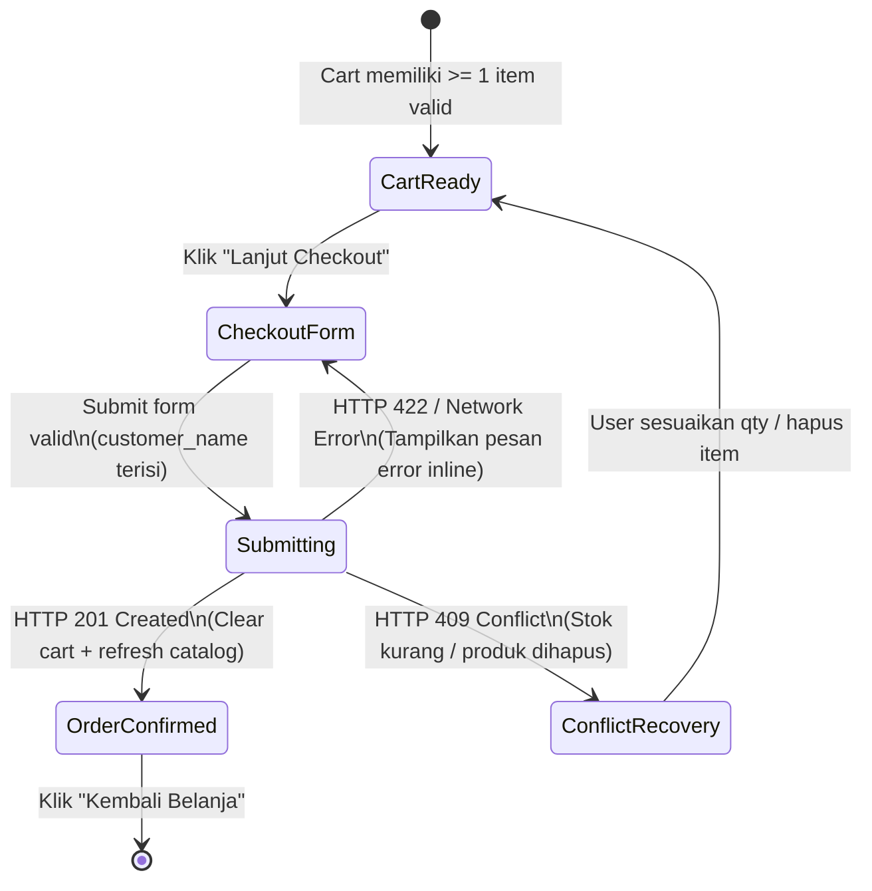

# User Flow Specification — MiniShop

Dokumen ini mendefinisikan alur perjalanan pengguna langkah demi langkah, transisi antar layar, serta state machine keranjang & checkout untuk sisi **Customer** maupun **Admin**.

---

## 1. Peta Rute Aplikasi (Frontend Routes)

| Route | Akses | Deskripsi |
|---|---|---|
| `/` | Public (Customer) | Halaman utama Product Catalog (search, filter kategori, grid produk, akses Cart Drawer & Detail Modal). |
| `/products/:id` | Public (Customer) | Tampilan detail produk yang dapat dibagikan/di-refresh langsung (membuka detail penuh + kontrol Add to Cart). |
| `/orders/:id/confirmation` | Public (Customer) | Halaman konfirmasi "Order Berhasil" berisi ringkasan lengkap order yang baru dibuat. |
| `/admin` | Admin | Redirect otomatis ke `/admin/products`. |
| `/admin/products` | Admin | Tabel CRUD produk (Tambah, Edit, Hapus + search & filter). |
| `/admin/orders` | Admin | Tabel daftar order masuk + modal detail order. |

---

## 2. Customer User Flows

### Flow C1: Jelajah Katalog, Pencarian, Filter & Detail Produk
1. User membuka `/` -> Navbar menampilkan brand **MiniShop**, tombol link **Admin**, dan tombol **Keranjang** (dengan badge jumlah item dari `localStorage`).
2. Frontend memuat `GET /api/v1/categories` dan `GET /api/v1/products` sambil menampilkan *skeleton cards* (tanpa layout shift).
3. Setelah data produk dimuat, `cartStore.syncWithCatalog(products)` berjalan diam-diam untuk memastikan data harga/stok item di keranjang selaras dengan server.
4. User mengetik kata kunci di kolom pencarian (contoh: `"keyboard"`):
   - Debounce 300ms memicu `GET /api/v1/products?search=keyboard&category=...`.
   - Jika tidak ditemukan, tampilkan Empty State **"Produk tidak ditemukan"** dengan tombol **"Reset Pencarian"**.
5. User mengklik pill kategori (contoh: `Aksesoris`):
   - Filter aktif diberi highlight kontras tinggi; daftar produk langsung diperbarui.
6. User mengklik kartu produk:
   - Membuka **Product Detail Modal** (atau navigasi ke `/products/:id`) yang menampilkan gambar besar, kategori, harga IDR, deskripsi lengkap, badge stok, pemilih kuantitas (`1..stock`), dan tombol **"Tambah ke Keranjang"**.
   - Jika `stock === 0`: badge **"Stok Habis"** tampil jelas dan tombol beli dalam kondisi `disabled`.

---

### Flow C2: Kelola Keranjang Belanja (Shopping Cart & Persistence)
1. User mengklik **"Tambah ke Keranjang"** dari kartu produk (qty `+1`) atau dari detail produk (qty pilihan):
   - `cartStore` memvalidasi `currentQtyInCart + addedQty <= product.stock`.
   - Jika berhasil: badge angka di ikon Keranjang bertambah, muncul toast singkat **"Ditambahkan ke keranjang"**.
   - Jika sudah mencapai batas stok: muncul toast informatif **"Jumlah di keranjang sudah mencapai batas stok tersedia (X)"**.
2. User menekan ikon **Keranjang** di navbar -> **Cart Drawer** meluncur masuk dari kanan (mobile: full-width sheet).
3. Di dalam Cart Drawer, user dapat:
   - Menekan `+` atau `-` atau mengetik angka langsung pada input qty (`1 <= qty <= maxStock`).
   - Melihat perubahan *line subtotal* (`harga x qty`) dan *Subtotal Keseluruhan* secara real-time.
   - Menekan ikon tempat sampah untuk menghapus item tertentu.
4. User menekan **Refresh Browser (F5)**:
   - Seluruh isi keranjang tetap ada karena tersimpan di `localStorage` (`minishop-cart-v1`).

---

### Flow C3: Checkout Happy Path & Konfirmasi Order

1. Dari Cart Drawer, user mengklik **"Lanjut Checkout"** -> membuka **Checkout Modal/Drawer View** berisi ringkasan item & total, plus form ringan:
   - Nama Pembeli (wajib).
   - Email (opsional, untuk catatan nota).
   - Catatan Pesanan (opsional).
2. User menekan **"Buat Pesanan"**:
   - Tombol berubah menjadi **"Memproses Pesanan..."** (`disabled`).
   - Frontend mengirim `POST /api/v1/orders`.
3. Backend memverifikasi & mengunci stok dalam transaksi atomik, membuat `orders` + `order_items`, mengurangi `products.stock`, lalu mengembalikan `201 Created` beserta objek order lengkap.
4. Frontend:
   - Mengosongkan `cartStore` (otomatis menghapus isi keranjang di `localStorage`).
   - Menutup drawer dan menavigasi ke `/orders/{id}/confirmation` (membawa state order agar instan, sekaligus mendukung `GET /api/v1/orders/{id}` jika halaman konfirmasi di-refresh).
5. Halaman **Order Berhasil** menampilkan ikon centang sukses, nomor order (`ORD-...`), tanggal transaksi, data pembeli, rincian tabel item (`nama`, `qty`, `harga satuan`, `subtotal`), total keseluruhan, dan tombol **"Kembali Belanja"**.

---

### Flow C4: Checkout Conflict Recovery (Stok Berubah Saat Checkout)
1. User A memiliki 2 unit "Laptop Sleeve" di keranjang, namun tepat sebelumnya User B membeli 1 unit sehingga stok server tersisa 1.
2. User A menekan **"Buat Pesanan"**.
3. Backend mendeteksi `requested_quantity (2) > available_stock (1)`, melakukan rollback transaksi, dan mengembalikan `409 Conflict` dengan detail item bermasalah.
4. Frontend menangkap response `409`, memanggil `cartStore.applyStockConflicts(errors.items)`, menampilkan banner peringatan jelas di atas ringkasan item (contoh: *"Stok Laptop Sleeve tersisa 1 unit. Sesuaikan jumlah untuk melanjutkan."*), serta tombol cepat **"Sesuaikan ke Stok Tersedia"** agar user bisa langsung melanjutkan checkout tanpa repot.

---

## 3. Admin User Flows (`/admin`)

### Flow A1: Kelola Produk (CRUD)
1. Dari navbar storefront, user mengklik **"Admin"** -> masuk ke `/admin/products`.
2. Admin melihat ringkasan metrik singkat (Total Produk Aktif, Stok Menipis/Habis, Total Order) dan tabel seluruh produk.
3. **Tambah Produk:**
   - Klik **"Tambah Produk"** -> modal form terbuka.
   - Isi Nama, Kategori, Harga (IDR), Stok, Deskripsi Singkat, dan URL Gambar (live preview gambar muncul otomatis).
   - Klik **"Simpan"** -> `POST /api/v1/products`.
   - Jika gagal validasi (`422`), tampilkan pesan error tepat di bawah field terkait.
   - Jika sukses (`201`), modal tertutup, tabel produk ter-refresh, dan toast **"Produk berhasil ditambahkan"** tampil.
4. **Edit Produk:**
   - Klik **"Edit"** pada baris produk -> modal form terbuka dengan nilai produk saat ini.
   - Ubah harga/stok/deskripsi -> klik **"Simpan Perubahan"** -> `PUT /api/v1/products/{id}` -> tabel ter-refresh.
5. **Hapus Produk:**
   - Klik **"Hapus"** pada baris produk -> muncul **Confirm Dialog** menampilkan nama produk serta catatan bahwa riwayat order lama tetap terjaga.
   - Klik **"Hapus Produk"** -> `DELETE /api/v1/products/{id}` -> produk hilang dari tabel Admin dan Storefront.

### Flow A2: Kelola Order & Detail Transaksi
1. Admin beralih ke tab **"Order"** (`/admin/orders`).
2. Tabel menampilkan seluruh order urut terbaru: Kode Order, Tanggal & Waktu, Nama Pembeli, Jumlah Item (`X produk / Y unit`), dan Total Nominal.
3. Admin mengklik baris order atau tombol **"Detail"**:
   - Memanggil `GET /api/v1/orders/{id}` dan membuka **Order Detail Modal**.
   - Modal menampilkan metadata pembeli, catatan pesanan, daftar produk yang dibeli dengan **harga satuan saat transaksi** (`unit_price`), quantity, subtotal per item, dan total nominal akhir.
